# RetailMax: E-Commerce Monolith Cloud Migration Platform

[](docs/ARCHITECTURE.md)
[](https://aws.amazon.com/rds/)
[](terraform/)
[](jenkins/Jenkinsfile)
[](monitoring/)
[](docs/MIGRATION_GUIDE.md)

> Enterprise-grade full-stack e-commerce monolithic application engineered for automated DevOps provisioning, continuous integration & deployment, zero-downtime Blue-Green cloud cutover, and high-availability AWS cloud hosting.

---

## 🌐 Live Cloud Deployment Endpoints

The complete cloud infrastructure and application stack is live on **Amazon Web Services (AWS)**:

| Service | Endpoint URL | Description |
| :--- | :--- | :--- |
| **🛍️ RetailMax Storefront** | [http://retailmax-alb-1087523635.us-east-1.elb.amazonaws.com](http://retailmax-alb-1087523635.us-east-1.elb.amazonaws.com) | Live public React SPA e-commerce store |
| **💚 ALB Health Check** | [http://retailmax-alb-1087523635.us-east-1.elb.amazonaws.com/health](http://retailmax-alb-1087523635.us-east-1.elb.amazonaws.com/health) | ALB target group health verification (Status: `UP`) |
| **📦 Products REST API** | [http://retailmax-alb-1087523635.us-east-1.elb.amazonaws.com/api/products](http://retailmax-alb-1087523635.us-east-1.elb.amazonaws.com/api/products) | Public API service connected to AWS RDS PostgreSQL |
| **📊 Grafana Dashboard** | [http://98.80.58.78:3031](http://98.80.58.78:3031) | Real-time observability dashboard (`admin` / `admin`) |
| **⚡ Prometheus Engine** | [http://98.80.58.78:9091](http://98.80.58.78:9091) | Live application & host metrics scraper |
| **📈 Raw App Metrics** | [http://retailmax-alb-1087523635.us-east-1.elb.amazonaws.com/metrics](http://retailmax-alb-1087523635.us-east-1.elb.amazonaws.com/metrics) | Prometheus-format application telemetry |

---

## 📌 Project Overview & Cloud Migration Objectives

RetailMax is an established online retailer running an e-commerce platform. This project delivers the modernization and complete migration lifecycle from local development to production on AWS:

1. **Modular Layered Monolith Architecture**: Built with strict separation of concerns across Config, Middlewares, Validators (Zod), Controllers, Services, and Repositories (Prisma ORM).
2. **Infrastructure as Code (IaC)**: Fully provisioned AWS VPC, Public/Private Subnets across 2 Availability Zones, Security Groups, Application Load Balancer with Blue/Green Target Groups, and managed RDS PostgreSQL 16 database.
3. **Automated CI/CD Pipeline**: 10-stage Jenkins declarative pipeline with automated SCM polling (`pollSCM`), Docker multi-stage builds, Trivy vulnerability scanning, automated cloud deployment, and zero-downtime cutover.
4. **Zero-Downtime Blue-Green Deployment**: Nginx reverse proxy and AWS ALB target groups enable seamless slot switching without customer disruption or dropped connections.
5. **Full-Stack Observability**: Native Prometheus instrumentation exposing latency histograms, request rates, error rates, Node.js runtime telemetry, and interactive Grafana dashboards.

---

## 🏗️ Architecture & Cloud Infrastructure

```
                                  [ Internet Users ]
                                           │
                                           ▼ (Port 80)
                       +---------------------------------------+
                       │    AWS Application Load Balancer      │
                       │    (retailmax-alb - Dual-AZ)          │
                       +---------------------------------------+
                                  │                 │
                (Blue Slot : 5001)│                 │(Green Slot : 5002)
                                  ▼                 ▼
             +─────────────────────────────────────────────────────────+
             │           AWS EC2 Application Host (t3.medium)          │
             │           Public IP: 98.80.58.78 (Static Elastic IP)    │
             │                                                         │
             │  +───────────────────────────────────────────────────+  │
             │  │   Nginx Ingress & Reverse Proxy (Ports 80/5001)   │  │
             │  +───────────────────────────────────────────────────+  │
             │          │                                   │          │
             │          ▼                                   ▼          │
             │  +───────────────────+               +───────────────+  │
             │  │  React Frontend   │               │  Express API  │  │
             │  │  SPA (Port 3030)  │               │  (Port 5050)  │  │
             │  +───────────────────+               +───────┬───────+  │
             │                                              │          │
             │  +─────────────────────+             +───────▼───────+  │
             │  │  Grafana Dashboard  │◄────────────│  Prometheus   │  │
             │  │  (Port 3031)        │  (Metrics)  │  (Port 9091)  │  │
             │  +─────────────────────+             +───────────────+  │
             +──────────────────────────────────────────────┬──────────+
                                                            │
                                        (Port 5432 - VPC Private Subnet)
                                                            ▼
                                        +──────────────────────────────+
                                        │   AWS RDS Managed Database   │
                                        │   PostgreSQL 16.3 (Dual-AZ)  │
                                        +──────────────────────────────+
```

### AWS Cloud Resource Breakdown:
- **VPC ID**: `vpc-0e7126c4e7b8856b8` (CIDR `10.0.0.0/16`)
- **Public Subnets**: `10.0.1.0/24` (`us-east-1a`), `10.0.2.0/24` (`us-east-1b`)
- **Private Subnets**: `10.0.10.0/24` (`us-east-1a`), `10.0.20.0/24` (`us-east-1b`)
- **ALB DNS**: `retailmax-alb-1087523635.us-east-1.elb.amazonaws.com`
- **RDS Endpoint**: `retailmax-postgres.cgxiws0ya25a.us-east-1.rds.amazonaws.com:5432`
- **EC2 Instance**: `98.80.58.78` (Static Elastic IP, Ubuntu 22.04 LTS, Docker CE, systemd node-exporter)

---

## 🛠️ Technology Stack

| Layer | Component | Description |
| :--- | :--- | :--- |
| **Frontend** | React 18, Vite, Tailwind CSS, Lucide Icons | Responsive SPA with catalog, drawer cart, checkout, admin |
| **Backend** | Node.js 20, Express.js | Layered Monolith with JWT, Helmet, Rate Limiter, CORS |
| **ORM & Database** | Prisma ORM, PostgreSQL 16 (AWS RDS) | Type-safe migrations, atomic transactions, connection pooling |
| **IaC** | HashiCorp Terraform | VPC, ALB, Target Groups, EC2, RDS, IAM Roles, Security Groups |
| **CI/CD** | Jenkins Declarative Pipeline | Cross-platform (Windows & Linux), automated SCM polling |
| **Containers** | Docker Engine, Docker Compose | Multi-stage production builds with Debian Slim & Alpine |
| **Reverse Proxy** | Nginx 1.25 Alpine | Blue-Green traffic switching, static SPA serving, API routing |
| **Observability** | Prometheus 2.51, Grafana 10.4 | Telemetry scrapers, PromQL, pre-provisioned dashboards |

---

## 🔄 Automated CI/CD Pipeline (Jenkins)

The pipeline is defined in [`jenkins/Jenkinsfile`](jenkins/Jenkinsfile) and executes **10 automated stages**:

```mermaid
flowchart LR
    A["1. SCM Checkout"] --> B["2. Syntax & Lint"]
    B --> C["3. Automated Tests"]
    C --> D["4. Docker Build"]
    D --> E["5. Trivy Security Scan"]
    E --> F["6. Push to AWS ECR"]
    F --> G["7. Terraform Validate"]
    G --> H["8. Deploy to EC2"]
    H --> I["9. Health Verification"]
    I --> J["10. Blue-Green Cutover"]
```



### Automatic Triggering on Code Push:
The pipeline includes automated SCM polling triggers:
```groovy
triggers {
    pollSCM('H/2 * * * *')  // Polls GitHub every 2 minutes for changes on branch 'main'
    githubPush()            // Instant trigger on GitHub Webhook push
}
```
Whenever a developer pushes code to `origin/main`, Jenkins automatically:
1. Validates syntax and executes test suites.
2. Builds optimized Docker container images.
3. Automatically triggers [`deploy/deploy-to-ec2.ps1`](deploy/deploy-to-ec2.ps1) to deploy to the live EC2 host (`98.80.58.78`).
4. Runs database schema synchronization (`npx prisma db push`) against AWS RDS.
5. Verifies live health on the ALB and completes cutover with **zero downtime**.

---

## 📊 Monitoring & Observability Stack

### 1. Grafana Performance Dashboard
- **URL**: [http://98.80.58.78:3031](http://98.80.58.78:3031)
- **Credentials**: `admin` / `admin`
- **Pre-provisioned Dashboard**: **RetailMax Telemetry Dashboard**
- **Panels**:
  - Request Throughput (Req/sec)
  - P50, P90, P99 Response Latency
  - HTTP Status Code breakdown (`2xx`, `3xx`, `4xx`, `5xx`)
  - Node.js Heap & RSS Memory Consumption
  - Event Loop Lag
  - Business KPIs: Total Orders Placed & Cumulative Revenue

### 2. Prometheus Metrics
- **URL**: [http://98.80.58.78:9091](http://98.80.58.78:9091)
- Scrapes the application every 10 seconds via `/metrics`.
- Health status visible at `Status ➔ Targets`.

---

## 🔑 Demo & Testing Credentials

| Role | Email | Password | Access & Capabilities |
| :--- | :--- | :--- | :--- |
| **Administrator** | `admin@retailmax.com` | `Admin@123` | Full Admin Dashboard (`/admin`), product CRUD, order status fulfillment |
| **Customer** | `user@retailmax.com` | `User@123` | Product catalog, cart persistence, checkout, order history |

> *Self-Registration: You can also click **"Create Account"** on the live website to register a brand-new user with immediate persistence in AWS RDS PostgreSQL.*

---

## 💻 Local Development Setup

### 1. Clone & Install
```bash
git clone https://github.com/Vishal0033/Ecommerce-Migration.git
cd "Ecommerce Migration"
npm run db:setup
```

### 2. Run Local Servers
```bash
# Start backend API (Port 5050)
npm run backend

# In a separate terminal, start frontend (Port 5174)
npm run frontend
```

### 3. Full Local Docker Stack
```bash
docker-compose up --build
```
Spins up the full stack locally with PostgreSQL (`5434`), Backend (`5050`), Frontend (`3030`), Nginx (`80`), Prometheus (`9091`), and Grafana (`3031`).

---

## ☁️ Manual Deployment to EC2

To deploy the latest changes to the live AWS EC2 host directly:
```powershell
.\deploy\deploy-to-ec2.ps1 -Ec2Ip "98.80.58.78"
```

---

## 📂 Project Directory Structure

```
Ecommerce Migration/
├── backend/
│   ├── prisma/
│   │   ├── schema.prisma              # Active Prisma schema
│   │   ├── schema.postgresql.prisma   # PostgreSQL AWS RDS schema
│   │   ├── schema.sqlite.prisma       # Local dev SQLite schema
│   │   └── seed.js                    # Idempotent DB seeder
│   ├── src/
│   │   ├── config/                    # Environment, Prisma Client, Logger
│   │   ├── controllers/               # Auth, Products, Cart, Orders, Admin
│   │   ├── middlewares/               # Security, RateLimit, JWT, Metrics
│   │   ├── repositories/              # Prisma data access layer
│   │   ├── routes/                    # API route endpoints
│   │   ├── services/                  # Business logic & transaction engine
│   │   ├── validators/                # Zod schemas
│   │   ├── app.js                     # Express app setup
│   │   └── server.js                  # HTTP server & graceful shutdown
│   ├── Dockerfile                     # Multi-stage production container
│   └── package.json
│
├── frontend/
│   ├── src/
│   │   ├── components/                # Navbar, Footer, ProductCard, CartDrawer
│   │   ├── context/                   # AuthContext, CartContext
│   │   ├── pages/                     # Storefront, Detail, Cart, Orders, Admin
│   │   ├── utils/                     # Axios API client (relative /api routing)
│   │   └── App.jsx
│   ├── Dockerfile                     # React build served via Nginx
│   └── package.json
│
├── terraform/                         # AWS Infrastructure as Code
│   ├── main.tf                        # VPC, Subnets, ALB, EC2, RDS, SG
│   ├── provider.tf                    # AWS Provider definition
│   ├── variables.tf                   # Configurable IaC parameters
│   ├── outputs.tf                     # ALB DNS, EC2 IP, RDS Endpoint
│   └── user_data.sh                   # EC2 cloud-init provisioning
│
├── ansible/                           # Configuration Management
│   ├── inventory/hosts.ini            # EC2 Host inventory
│   ├── playbooks/site.yml             # Master deployment playbook
│   └── roles/                         # Docker, Nginx, RetailMax, Monitoring
│
├── jenkins/
│   └── Jenkinsfile                    # 10-Stage Declarative CI/CD Pipeline
│
├── monitoring/
│   ├── prometheus/prometheus.yml      # Metrics scraper config
│   └── grafana/                       # Dashboards & Datasource provisioning
│
├── deploy/
│   └── deploy-to-ec2.ps1              # Direct EC2 deployment runner
│
├── docker-compose.prod.yml            # Production cloud container stack
├── docker-compose.yml                 # Local dev full stack
└── README.md
```

---

## 📜 Documentation Links
- 📘 [Architectural Design Document](docs/ARCHITECTURE.md)
- 📗 [REST API Specification](docs/API_DOCS.md)
- 📙 [AWS Cloud Migration Guide](docs/MIGRATION_GUIDE.md)
